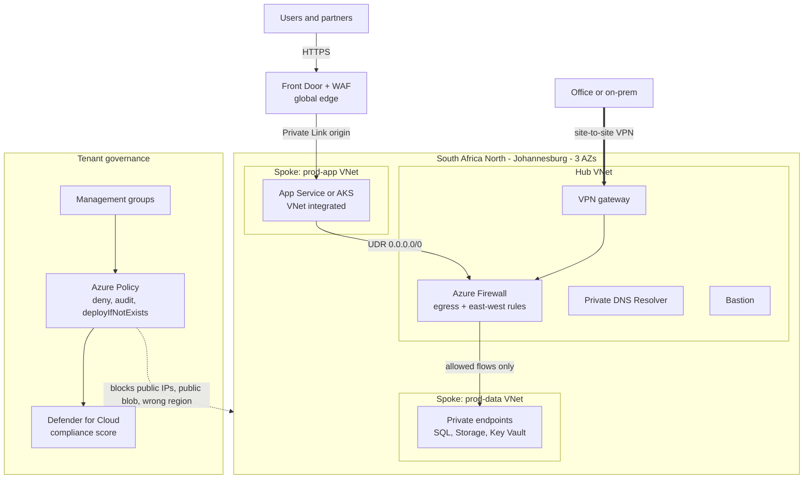
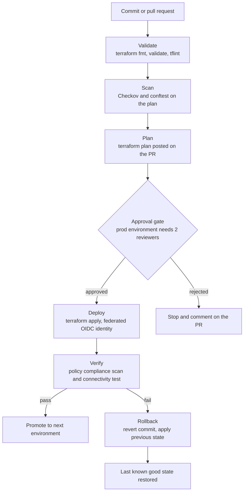
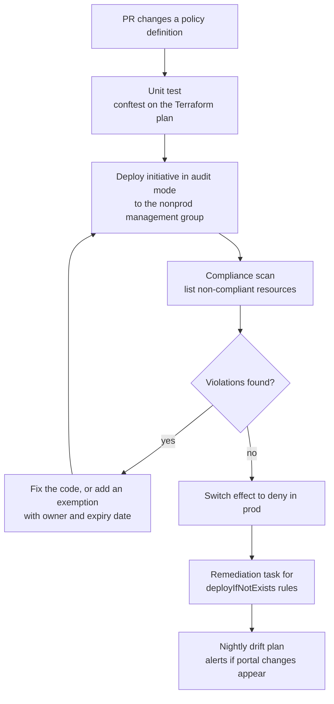

# Regulated Landing Zone

A hub-and-spoke Azure landing zone where every guardrail is code: private-only networking, firewall-inspected traffic, and Azure Policy that blocks non-compliant deployments before they exist.

### Business use case

A South African bank, insurer or municipality moving workloads into South Africa North has to show POPIA-minded controls: no public endpoints, encryption everywhere, logging on, region locked. Today auditors get spreadsheets. Here they get a live policy compliance report and a Git history of every change.

### The hard piece

Policy-as-code plus zero-trust networking

### Rough monthly cost, ZAR

R300 to R900 a month if you apply for a few hours and destroy. Left running, Azure Firewall alone is roughly R5,000 a month, so keep it in a module you apply only for sessions and demos.

### Tool stack

- Terraform (azurerm + AzAPI)
- Azure Landing Zone / Verified Modules
- Management groups
- Azure Policy + initiatives
- Defender for Cloud
- Azure Firewall
- Hub-spoke VNet peering
- Private Endpoints + Private DNS
- Private DNS Resolver
- Bastion
- Front Door + WAF
- Log Analytics
- GitHub Actions + OIDC
- Checkov
- conftest (OPA)
- tflint

### Diagrams

#### Diagram 1 · Architecture: hub, spokes and governance

> **How to read this:** A user hits Front Door, which reaches the app spoke over Private Link, so the app never needs a public IP. When the app calls the database, a user-defined route sends the packet through the hub firewall, and only then does it reach the private endpoint in the data spoke. The dotted line is governance: Azure Policy sits above all of it and rejects a deployment that breaks the rules.

#### Diagram 2 · CI/CD: landing zone changes

> **How to read this:** Follow the top line from a commit to a deploy: the pipeline stops at the first red step, and nothing reaches the approval gate unless validation, scanning and the plan all passed. The bottom branch is the one hiring managers ask about: when verification fails, the rollback box puts the environment back without a human editing the console. Here the scan step also runs your custom policy tests, so a policy change is tested like application code.

#### Diagram 3 · Hard piece: shipping a policy safely

> **How to read this:** A new rule never goes straight to deny. It runs in audit mode first, you read what it would have broken, and only a clean scan promotes it. The loop on the left is the part to write about in your README: exemptions carry an owner and an expiry so they cannot become permanent holes.

### How it covers the five focus areas

- **Compute** (light): Workload spoke runs App Service (VNet integrated) or a small AKS cluster; a VM Scale Set bastion-fronted batch tier shows autoscale. Policy denies public IPs on VMs and restricts SKUs to an approved list.
- **Networking · HOME**: Hub-and-spoke with a user-defined route (0.0.0.0/0) to Azure Firewall, NSGs plus application security groups, private endpoints for SQL, Storage and Key Vault, Private DNS zones linked to the hub, DNS resolver for on-prem name lookups, Front Door with a Private Link origin.
- **Storage** (light): Policy enforces secure transfer, no public blob access and customer-managed keys in Key Vault. Diagnostic logs land in a storage account with an immutability policy.
- **CI/CD** (deep): Plan on PR, conftest policy tests, environment approvals, federated identity (no stored secrets), nightly drift detection with an issue opened automatically.
- **Cost optimisation** (light): Tags required and inherited by policy, a budget per spoke, firewall applied on a schedule, dev spokes auto-shutdown.
### Advanced features that show depth

- Custom policy definitions with DeployIfNotExists that attach diagnostic settings to every new resource
- Policy exemptions that expire, tracked in a table so reviews are not forgotten
- Split-horizon Private DNS: the same name resolves privately inside the VNets and publicly outside
- Privileged Identity Management for owner access and a documented break-glass account
- Map your initiative to ISO 27001 or the CIS benchmark and write down which control supports which POPIA condition

### Production-like touches

- Three subscriptions as environments: platform, nonprod, prod
- Alerts on non-compliance spikes and firewall deny bursts
- Runbook: add a new spoke in under 30 minutes
- Post-incident write-up: an app outage caused by a Private DNS zone that was never linked to the spoke
- Architecture decision records and the diagrams kept as code in the repo

### AWS to Azure bridge

| AWS | Azure | Where it trips up AWS engineers |
| --- | --- | --- |
| Organizations + SCPs | Management groups + Azure Policy | Policy can also fix things (deployIfNotExists). RBAC is a separate system from Policy. |
| Transit Gateway | Hub VNet + peering (or Virtual WAN) | Peering is not transitive. Traffic only crosses spokes if it passes a firewall with routes you write. |
| Security group | NSG | NSGs have numbered priorities and a default rule that allows VNet-to-VNet traffic. It is not default-deny inside the VNet. |
| VPC endpoint / PrivateLink | Private Endpoint | You must also create and link the privatelink Private DNS zone, or the name still resolves to a public IP. This breaks more first deployments than anything else. |
| IAM Identity Center | Entra ID + PIM | Identity lives in the tenant, not the subscription. Roles are assigned at a scope and inherit downwards. |
| Network Firewall | Azure Firewall | Billed every hour it exists. Destroy it between sessions. |

### Résumé pitch

- Designed and codified a hub-and-spoke Azure landing zone in Terraform with \[N\] custom policy definitions, enforcing zero public endpoints across \[N\] spokes.
- Cut new-environment provisioning from days to under \[N\] minutes by vending spokes through a reviewed pull request and OIDC-authenticated pipeline.
- Introduced audit-then-deny policy rollout with expiring exemptions, reaching \[N\]% compliance with no production deployment blocked unexpectedly.

> *Replace every \[N\] with a number you measured. If you cannot measure it, remove the claim.*
