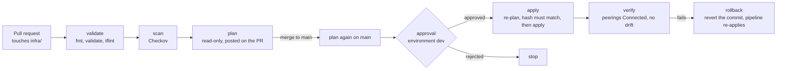

# Pipeline (piece 4)

GitHub Actions runs Terraform for this project: [`.github/workflows/terraform.yml`](../.github/workflows/terraform.yml). It is Diagram 2 of the [README](../README.md) made real. Azure sign-in uses **OIDC federation**, so GitHub holds no client secret.

## The flow



| Job | Runs on | What it does | Signs in as |
| --- | --- | --- | --- |
| validate | PR and main | `terraform fmt -check`, `validate`, `tflint` | nobody |
| scan | PR and main | Checkov on `infra/` | nobody |
| plan | PR and main | `terraform plan`, read-only, no state lock. Comments the plan on the PR | plan identity |
| apply | main, only if there are changes | Waits for approval, re-plans, fails if the plan differs from the one shown, then applies | apply identity |
| verify | after apply | Every VNet peering is `Connected`, and a fresh plan shows no drift | plan identity |

**Approve what you saw.** The plan job stores a hash of the plan text. After approval the apply job plans again, and refuses to apply if the hash differs, meaning something changed between the plan and the approval. No plan file is stored as an artifact, which matters because the repo is public and artifacts are downloadable.

**Rollback.** The pipeline does not undo a failed verify automatically. Revert the commit and merge the revert, and the same pipeline applies the previous state.

**Not in the pipeline yet.** conftest policy tests and the Azure Policy compliance scan arrive in piece 5 with the policies. The verify step then gains the compliance check described in [policy-rollout.md](policy-rollout.md).

## The two identities

| Identity | Can sign in from | Roles | Why |
| --- | --- | --- | --- |
| `gha-landing-zone-plan` | pull requests, `main` | Reader on the subscription, Storage Blob Data **Reader** on the state account | A pull request can read Azure and state but can **never change anything** |
| `gha-landing-zone-apply` | the `dev` environment only | Contributor on the subscription, Storage Blob Data Contributor on the state account | Only runs after a reviewer approves |

Each has federated credentials, one per allowed workflow context, and no secret:

| Credential subject | Used by |
| --- | --- |
| `repo:<owner>/<repo>:pull_request` | plan on pull requests |
| `repo:<owner>/<repo>:ref:refs/heads/main` | plan and verify on main |
| `repo:<owner>/<repo>:environment:dev` | apply |

A token minted for one context cannot be exchanged for another identity. A pull request cannot reach the apply identity at all, because its subject is `pull_request`, not `environment:dev`.

## One-time setup

Creating identities and role assignments needs the same temporary elevated access as [service-principal.md](service-principal.md):

1. Entra admin center → **Identity → Overview → Properties** → **Access management for Azure resources** → **Yes**. Then `az logout && az login`.
2. Run the script from the project folder. It needs `gh` logged in with admin rights on the repo.
   ```bash
   cd azure/regulated-landing-zone
   STATE_ACCOUNT=stlztf31860625 TF_OWNER=sharif ./scripts/create-pipeline-identities.sh
   ```
3. Turn elevated access back to **No**, then `az logout && az login`.

The script creates the two identities and their federated credentials, assigns the roles, sets these on the GitHub repo, and creates the `dev` environment with you as required reviewer, deployable from `main` only:

| Kind | Name | Holds |
| --- | --- | --- |
| Secret | `AZURE_TENANT_ID`, `AZURE_SUBSCRIPTION_ID`, `AZURE_PLAN_CLIENT_ID`, `AZURE_APPLY_CLIENT_ID` | IDs, not credentials. They are secrets so that GitHub masks them in public logs |
| Variable | `TFSTATE_RG`, `TFSTATE_ACCOUNT`, `TF_OWNER` | Names used to find the state and tag resources |

## Testing it

```bash
git checkout -b test-pipeline
# make a harmless change under infra/, for example add a tag in locals.tf
git commit -am "Test pipeline" && git push -u origin test-pipeline
gh pr create --fill
```

Expect validate, scan and plan to run on the PR, with the plan posted as a comment. Merge it and the apply job pauses for your approval in the **Actions** tab. Approve it, and verify runs after the apply.

## Public repo precautions

- Workflow logs and PR comments are public. IDs are stored as secrets so logs mask them, and the plan comment has the subscription ID removed before posting.
- The workflow uses `pull_request`, not `pull_request_target`, so pull requests from forks get no secrets and no Azure access.
- In the repo's **Settings → Actions → General**, set "Fork pull request workflows" to require approval for all outside collaborators.
- Third-party actions (setup-terraform, azure/login, setup-tflint, Checkov) are pinned to full commit SHAs, with the version in a comment, because the jobs that use them can sign in to Azure. Dependabot opens weekly pull requests to update them, and each one goes through this same pipeline. GitHub's own `actions/*` stay on major tags.
- **Accepted risk:** the PR plan identity can read the state, so anyone with write access to the repo could change the workflow to print it. The state holds no secrets today and only the owner has write access. Revisit before adding collaborators or storing secrets in state; see [hiccups.md](hiccups.md), entry 5.
- The `dev` environment needs your approval even if someone else could push to `main`.
